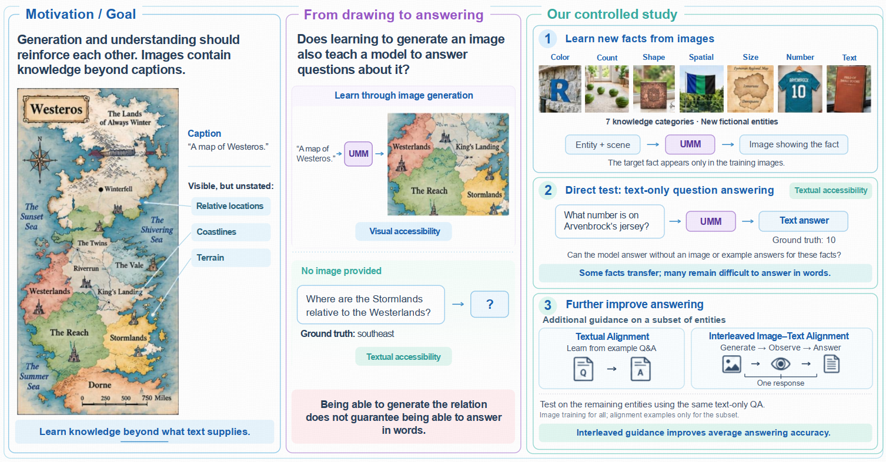
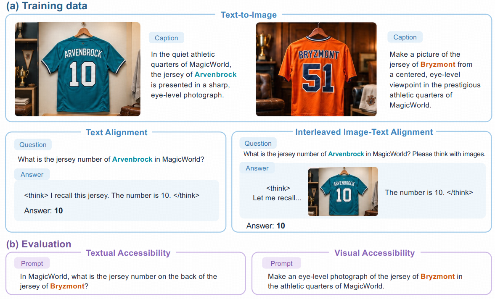

# Can Visual Generation Expand What Unified Multimodal Models Know?

<p align="center">
  <a href="https://kevinlunatic.github.io/Knowledge-Transfer-Probing/">
    
  </a>
  <a href="https://arxiv.org/abs/2610.21459">
    
  </a>
</p>

<p align="center">
    
</p>

We introduce **Knowledge Transfer Probing (KTP)**, a controlled protocol to test whether visual generation expands what UMMs know. The protocol controls the source of target knowledge and reduces interference from pretrained associations. It evaluates whether knowledge supplied through generation-training images becomes usable in text-only QA, taking a first step toward measuring the knowledge contribution of visual generation.

## 📥 Dataset

<p align="center">
    
</p>

The released data is organized into training and evaluation files under [`ktp-data`](ktp-data).

```text
ktp-data/
├── train/
│   ├── t2i_train.jsonl                               # Text-to-image training
│   ├── text_alignment_train.jsonl                    # Text alignment
│   ├── interleaved_image-text_alignment_train.jsonl  # Image-text alignment
│   └── images-*.zip                                  # Shared image archives
└── eval/
    ├── textual_accessibility.jsonl                   # Text QA and reference answers
    └── visual_accessibility.jsonl                    # Generation prompts and reference attributes
```

See the [paper](https://arxiv.org/abs/2610.21459) for dataset construction and split details.

**Data format**

Each JSONL record contains `msg` (conversation messages) and `meta` (task, entity,
and reference information). For image targets, the assistant's `<image>` marker
refers to `image_path`. Resolve this path relative to the JSONL file: training
paths use `images/...`, while visual evaluation paths use `../train/images/...`.

**Download and extract images**

With [Git LFS](https://git-lfs.com/) installed, run from the repository root:

```bash
git lfs install --local
git lfs pull --include="ktp-data/train/images-*.zip"
for archive in ktp-data/train/images-*.zip; do
    unzip -q -n "$archive" -d ktp-data/train
done
```

This creates the shared `ktp-data/train/images/` directory.

## 📊 Evaluation

Both scoring scripts use only the Python standard library. They score saved
responses and report overall and per-task metrics. With `--output-dir`, they
also save `results.jsonl` and `summary.json`.

The commands below use the [example responses](examples/).
Replace `--input` with your own response JSONL file.

### Textual accessibility scoring

Use [textual_accessibility.jsonl](ktp-data/eval/textual_accessibility.jsonl).
Send only the user question in `msg` to the model. Save its complete response
as a top-level `raw_output` string. Keep `meta` and any thinking delimiters
in the response, including an assistant `<think>` prefill.

[evaluate_textual_accessibility.py](scripts/evaluate_textual_accessibility.py)
uses **normalized exact match**. It removes thinking blocks and normalizes
case, whitespace, and trailing periods. Extra wording counts as incorrect.

```bash
python scripts/evaluate_textual_accessibility.py \
    --input examples/textual_accessibility.jsonl \
    --output-dir ./ktp-text-eval
```

### Visual accessibility prompts

[visual_accessibility_prompts.py](scripts/visual_accessibility_prompts.py)
contains the VLM judging prompts for all seven tasks. Render a prompt with
`build_prompt(task, **fields)` and send it with the generated image to the VLM.
Required fields are listed at the top of the script.

```python
from scripts.visual_accessibility_prompts import build_prompt

prompt = build_prompt("color", char="R", char_label_en="uppercase R", color="blue")
```

### Visual accessibility scoring

Generate images from the prompts in
[visual_accessibility.jsonl](ktp-data/eval/visual_accessibility.jsonl).
Judge each image with the VLM prompts above. Save the VLM response as a
top-level `raw_output` string in the corresponding record and keep `meta`.

[evaluate_visual_accessibility.py](scripts/evaluate_visual_accessibility.py)
reports **`consistent_rate`**: passing judgments divided by valid judgments.
Malformed responses are counted as errors and excluded from this rate.
Task-specific scoring rules are listed at the top of the script.

```bash
python scripts/evaluate_visual_accessibility.py \
    --input examples/visual_accessibility.jsonl \
    --output-dir ./ktp-visual-eval
```

## ✒️ Citation

```bibtex
@misc{li2026visualgenerationexpandunified,
      title={Can Visual Generation Expand What Unified Multimodal Models Know?}, 
      author={Wenkai Li and Wenyi Hong and Zhuoyi Yang and Jie Tang},
      year={2026},
      eprint={2610.21459},
      archivePrefix={arXiv},
      primaryClass={cs.CV},
      url={https://arxiv.org/abs/2610.21459}, 
}
```
